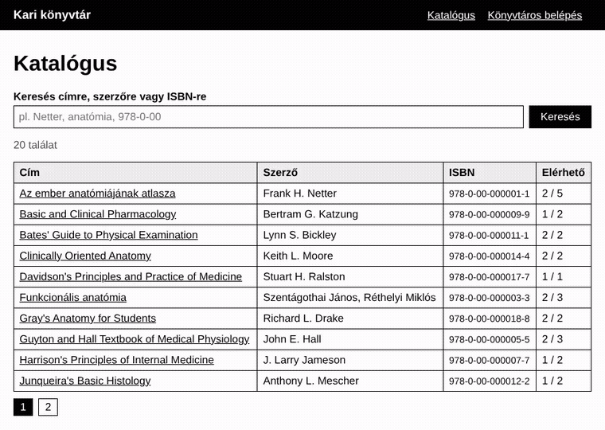
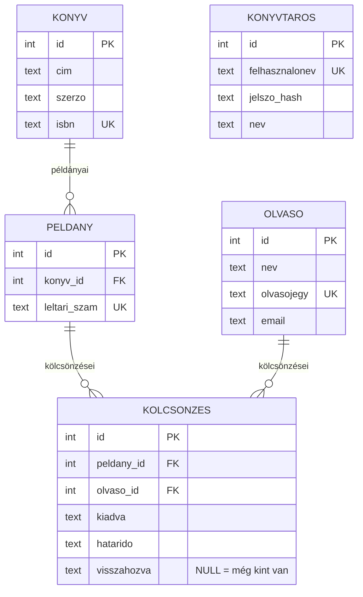

# Könyvtári kölcsönzés-nyilvántartó (p14)

Egyéni projekt a Webfejlesztés Gyakorló Műhelyből (PHP, 2. szint).
A kari könyvtár könyveit, példányait, olvasóit és kölcsönzéseit tartja nyilván:
ki vitte el a Netter-atlaszt, és mikor hozza vissza.



## Futtatás

```bash
cd Eloadas/konyvtar
php -S localhost:8000 -t public
```

Aztán: http://localhost:8000

- Az adatbázis (`konyvtar.db`, SQLite) első indításkor magától létrejön a `schema.sql` és a `seed.sql` alapján.
  Kézzel is betölthető: `sqlite3 konyvtar.db < schema.sql && sqlite3 konyvtar.db < seed.sql`
- Újrakezdéshez elég törölni a `konyvtar.db` fájlt.
- Könyvtáros belépés: **konyvtaros** / **Konyvtar2026!**
- Kell hozzá: PHP 8.1+ a `pdo_sqlite` bővítménnyel.

## Mit tud

- **Katalógus** (belépés nélkül is): keresés címre, szerzőre vagy ISBN-re, lapozással (10/oldal); könyvenként az elérhető/összes példány.
- **Könyv oldala:** a példányok leltári számmal és állapottal (elérhető / kint van, határidővel).
- **Kölcsönzés** (csak könyvtárosnak): kiadás leltári szám + olvasó alapján, a határidő a kiadás napja + 14 nap; visszavétel a késés napjainak kiszámításával.
- **Lejártak:** a lejárt kölcsönzések olvasónként csoportosítva, **CSV-export** (Excelben is ékezethelyesen).
- **Olvasók:** lista a kint lévő és lejárt könyvek számával; olvasónként a teljes kölcsönzési előzmény.

## Mappaszerkezet

```
konyvtar/
├── public/                  ← ez a webgyökér: csak ez érhető el böngészőből
│   ├── index.php            katalógus, keresés, lapozás
│   ├── konyv.php            egy könyv példányai
│   ├── belepes.php          könyvtáros belépés
│   ├── kilepes.php          kilépés (csak POST)
│   ├── kolcsonzes.php       kiadás, visszavétel, kint lévő könyvek
│   ├── lejart.php           lejárt kölcsönzések + CSV
│   ├── olvasok.php          olvasók listája
│   ├── olvaso.php           egy olvasó előzménye
│   └── style.css
├── src/                     ← PHP-kód, kívülről nem elérhető
│   ├── bootstrap.php        közös: beállítások, munkamenet, e(), CSRF, flash, belépés-ellenőrzés
│   ├── layout.php           fejléc + menü, lábléc
│   ├── Db.php               PDO-kapcsolat (SQLite, foreign_keys = ON)
│   ├── KonyvRepository.php, OlvasoRepository.php,
│   ├── KolcsonzesRepository.php, KonyvtarosRepository.php   ← MINDEN SQL itt van
│   └── KolcsonzesHiba.php   üzleti szabály megsértése (pl. már ki van adva)
├── schema.sql               táblák, idegen kulcsok, indexek
├── seed.sql                 20 könyv, 45 példány, 15 olvasó, 20 kölcsönzés
├── docs/demo.gif
└── TESTS.md                 tesztesetek
```

Egyszerű szabály: **az oldalak (`public/`) nem írnak SQL-t**, csak meghívják a Repository osztályokat. Ha egy lekérdezést keresel, a `src/*Repository.php` fájlokban van.

## Adatmodell (ER-diagram)



A **könyv** és a **példány** külön tábla: egy könyvnek több példánya lehet (a Netter-atlasznak 5), és kölcsönözni mindig egy konkrét példányt lehet, a leltári száma alapján.

## A fontos lekérdezések

**Elérhető példányok száma könyvenként** (`KonyvRepository::keres`) – egy példány akkor elérhető, ha nincs nyitott (`visszahozva IS NULL`) kölcsönzése. A `LEFT JOIN` a nyitott kölcsönzést csatolja, ha van; ahol nincs, ott `ko.id` NULL, és a `COUNT(ko.id)` nem számolja:

```sql
SELECT k.id, k.cim, COUNT(p.id) AS osszes, COUNT(p.id) - COUNT(ko.id) AS elerheto
  FROM konyv k
  LEFT JOIN peldany p     ON p.konyv_id = k.id
  LEFT JOIN kolcsonzes ko ON ko.peldany_id = p.id AND ko.visszahozva IS NULL
 WHERE k.cim LIKE ? ESCAPE '\' OR k.szerzo LIKE ? ESCAPE '\' OR k.isbn LIKE ? ESCAPE '\'
 GROUP BY k.id ORDER BY k.cim LIMIT ? OFFSET ?
```

**Lejárt kölcsönzések** (`KolcsonzesRepository::lejartak`) – nyitott, és a határidő a mai nap előtt van; 4 tábla JOIN-ja, olvasó szerint rendezve, a PHP olvasónként csoportosítja:

```sql
SELECT ko.id, ko.hatarido, p.leltari_szam, k.cim, o.id AS olvaso_id, o.nev AS olvaso_nev
  FROM kolcsonzes ko
  JOIN peldany p ON p.id = ko.peldany_id
  JOIN konyv k   ON k.id = p.konyv_id
  JOIN olvaso o  ON o.id = ko.olvaso_id
 WHERE ko.visszahozva IS NULL AND ko.hatarido < ?
 ORDER BY o.nev, ko.hatarido
```

**Egy olvasó előzménye** (`KolcsonzesRepository::elozmeny`) – ugyanez a JOIN, `WHERE ko.olvaso_id = ?`, a legújabb elöl.

**Dupla kiadás elleni védelem** – két szinten:

1. `KolcsonzesRepository::kiad`: az ellenőrzés („ki van-e már adva?”) és az `INSERT` egy tranzakcióban fut (`BEGIN IMMEDIATE`), így két egyszerre érkező kérés nem tud egymásba futni.
2. Az adatbázisban egy **részleges egyedi index**: egy példánynak egyszerre csak egy nyitott kölcsönzése lehet. Ha valami mégis átcsúszna, a második `INSERT` hibára fut.

```sql
CREATE UNIQUE INDEX egy_nyitott_kolcsonzes ON kolcsonzes (peldany_id) WHERE visszahozva IS NULL;
```

**Késés** (`KolcsonzesRepository::kesesNapok`) – a határidő és a visszahozás (vagy, ha még kint van, a mai nap) közötti napok száma, `DateTime::diff`-fel; határidőn belül 0.

## Biztonság röviden

| Mi ellen | Hogyan | Hol |
|---|---|---|
| SQL injection | minden lekérdezés prepared statement (`?` helyőrző); a LIKE-ban a `%` és `_` escape-elve | `src/*Repository.php` |
| XSS | minden kiírt adat `e()` = `htmlspecialchars(…, ENT_QUOTES)` | `src/bootstrap.php`, minden oldal |
| CSRF | minden POST-űrlapban token, `hash_equals` ellenőrzés → 403 | `csrf_mezo()`, `csrf_ellenoriz()` |
| Jogosulatlan hozzáférés | kölcsönzés, lejártak, olvasók: belépés nélkül 302 → `belepes.php` | `belepes_kell()` |
| Jelszó | csak `password_hash` kerül az adatbázisba, `password_verify` ellenőriz, belépéskor `session_regenerate_id` | `belepes.php` |
| Nyílt átirányítás | a `vissza` paraméter csak saját `.php` oldal lehet | `biztonsagos_vissza()` |
| Az adatbázis letöltése | a `konyvtar.db` a `public/` mappán kívül van | `bootstrap.php` |
| CSV-befecskendezés | az `=`, `+`, `-`, `@` kezdetű cellák elé `'` kerül | `lejart.php` |

## Kapcsolat a Műhellyel

| A projektben | A Műhelyben |
|---|---|
| űrlap → POST → ellenőrzés → mentés → 303 → GET, flash üzenet (PRG) | php01 Vendégkönyv |
| adatot módosító művelet csak POST + CSRF-token; nem létező azonosító → 404, rossz metódus → 405 | php04 Jegyzetek CRUD; antipattern: „GET kérés állapotváltoztatásra” |
| `password_hash` / `password_verify`, általános hibaüzenet belépésnél | php05 Regisztráció és bejelentkezés; antipattern: „Jelszó nyílt szövegben” |
| paraméterezett LIKE keresés `%` és `_` escape-pel, LIMIT/OFFSET lapozás, lapszám beszorítása | php10 Keresés és lapozás |
| dupla kiadás ellen tranzakció + egyedi index | php11 Kurzusjelentkezés kapacitással; antipattern: „Ellenőrzés, majd írás (versenyhelyzet)” |
| CSV-export BOM-mal | php22 CSV import/export |
| szerveroldali ellenőrzés minden bemenetre | alapelv: „Ne bízz a kliensben”; antipattern: „Csak kliensoldali validálás” |
| SQL-összefűzés, XSS, CSRF, idegen adat elérése – amit a bh03-ban javítani kellett, az itt eleve jól van | Bug hunting bh03 |
