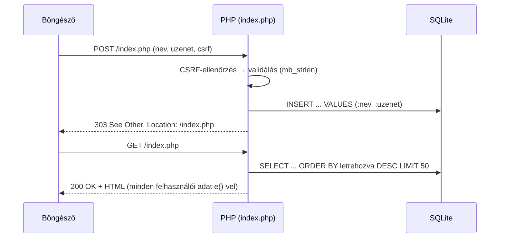

# Vendégkönyv – UMFST nyílt nap

Egyszerű PHP-alkalmazás: a látogatók beírják a nevüket és egy rövid üzenetet, a bejegyzések pedig a legújabbal kezdve jelennek meg.

A cél a klasszikus szerveroldali űrlap teljes útjának megértése: **POST → ellenőrzés → mentés → 303 átirányítás → GET** (Post/Redirect/Get minta), és a három alapvető védekezés: **XSS**, **SQL injection** és **CSRF** ellen.

> Gyakorló Műhely: PHP mintaalkalmazás 1 (php01) · Kurzus: K3 · Első alkalmazás: Vendégkönyv hat lépésben

## Futtatás

Kell hozzá: PHP 8.1 vagy újabb, `pdo_sqlite` bővítménnyel (`php -m | grep -i sqlite`).

```bash
cd Eloadas/vendegkonyv      # a WebLabor repó gyökeréből
php -S localhost:8000
```

Ezután nyisd meg a böngészőben: <http://localhost:8000>

Az adatbázis (`vendegkonyv.sqlite`) az első kéréskor magától létrejön. Tiszta lapért töröld a fájlt.

## Fájlok

| Fájl | Mit csinál |
|---|---|
| `index.php` | Az egyetlen oldal. **POST**: CSRF-ellenőrzés, validálás, mentés, 303 átirányítás. **GET**: üzenetek, űrlap, lista. |
| `db.php` | `db()`: PDO-kapcsolat az SQLite-hoz · `e()`: biztonságos kiírás HTML-be · `helyi_ido()`: UTC → helyi idő |
| `csrf.php` | `csrf_token()` és `csrf_check()`: védelem a hamisított űrlapbeküldés ellen |
| `schema.sql` | A `bejegyzes` tábla szerkezete (hosszkorlát `CHECK`-kel az adatbázis szintjén is) |
| `style.css` | Kinézet, sötét móddal és jól látható fókusszal |
| `teszt.sh` | 25 automatikus teszt curl-lel |
| `TESTS.md` | Kézi és automatikus tesztesetek |

## A kérés útja



Mivel a POST válasza mindig átirányítás, a frissítés (F5) csak a GET-et ismétli meg, így nem lesz dupla bejegyzés.

## Biztonság

| Veszély | Védekezés | Hol |
|---|---|---|
| **XSS** – beírt `<script>` lefut a többiek böngészőjében | Kimenet escape-elése: `htmlspecialchars()` az `e()`-ben, minden kiírásnál. Az adatot nyersen tároljuk, kiíráskor escape-elünk. | `db.php`, `index.php` |
| **SQL injection** – a bemenet SQL-kóddá válik | Prepared statement helyőrzőkkel (`:nev`, `:uzenet`), valódi (nem emulált) előkészítéssel | `index.php`, `db.php` |
| **CSRF** – idegen oldal küld űrlapot a látogató nevében | Véletlen token a munkamenetben + rejtett mezőben, `hash_equals()` összehasonlítás; `SameSite=Lax` süti | `csrf.php` |
| Kliensoldali ellenőrzés megkerülése | Szerveroldali validálás (`mb_strlen`), és `CHECK` feltétel az adatbázisban is | `index.php`, `schema.sql` |
| Dupla beküldés | Post/Redirect/Get (303) | `index.php` |

## Tesztelés

Az egyik terminálfülön fusson a szerver, a másikon:

```bash
bash teszt.sh
```

Elvárt eredmény: `Eredmény: 25 sikeres, 0 sikertelen`. A kézi tesztek a [TESTS.md](TESTS.md) fájlban vannak.

## Továbbfejlesztési ötletek (a Műhely kihívása)

- Lapozás (10 bejegyzés oldalanként)
- „Méhkas” (honeypot) spamszűrő mező
- Sebességkorlát: 1 bejegyzés / 30 másodperc / munkamenet
- Jelszóval védett moderátor-oldal, ahol POST + CSRF tokennel törölni lehet
